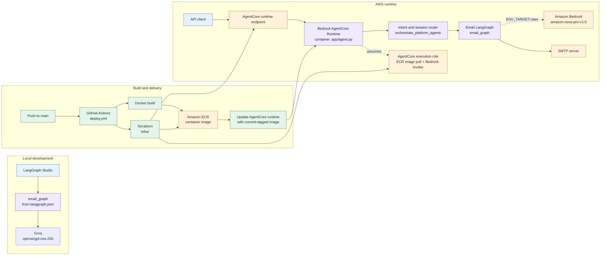
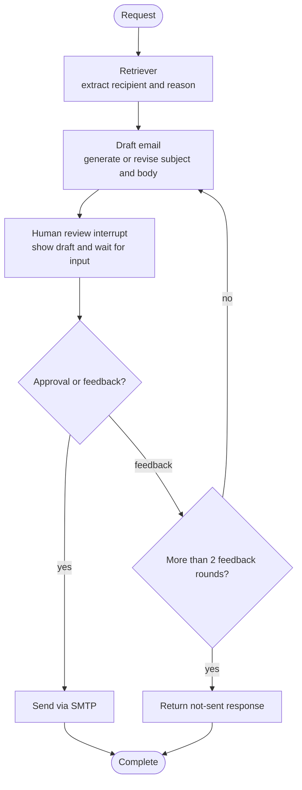

# Architecture

This page diagrams the architecture implemented by the repository: local LangGraph Studio development, the AgentCore runtime path, the email workflow, and the GitHub Actions deployment path.

## Platform overview

## Email workflow

The platform router sends new email-related requests to the email graph. If a session is paused for review, the next input resumes that graph; approval sends the email, while feedback requests another draft.

The graph shares `EmailState` between nodes. Structured output schemas (`UserDetails` and `DraftEmail`) define the LLM extraction and draft results. Requests that do not match the email intent currently receive the router's fallback response.

## Configuration notes

- The LLM connector is selected by `ENV_TARGET`: `aws` uses Amazon Bedrock; any other value (including the default `local`) uses Groq. Terraform currently does not set `ENV_TARGET`, so the deployed container defaults to the Groq path unless it is configured separately.
- The GitHub Actions workflow builds a Docker image, but the checked-in `Dockerfile` currently contains only a comment. The image build step therefore needs a real Dockerfile before this deployment path can run successfully.
- The graph is compiled without an explicit checkpointer, while the AgentCore entrypoint queries graph state to resume interrupted sessions. Verify the runtime's thread-state integration before relying on approval/resume across requests.
- Local Studio loads `email_graph` directly from `langgraph.json`; the AWS AgentCore entrypoint and intent router are in `app/agent.py`.
